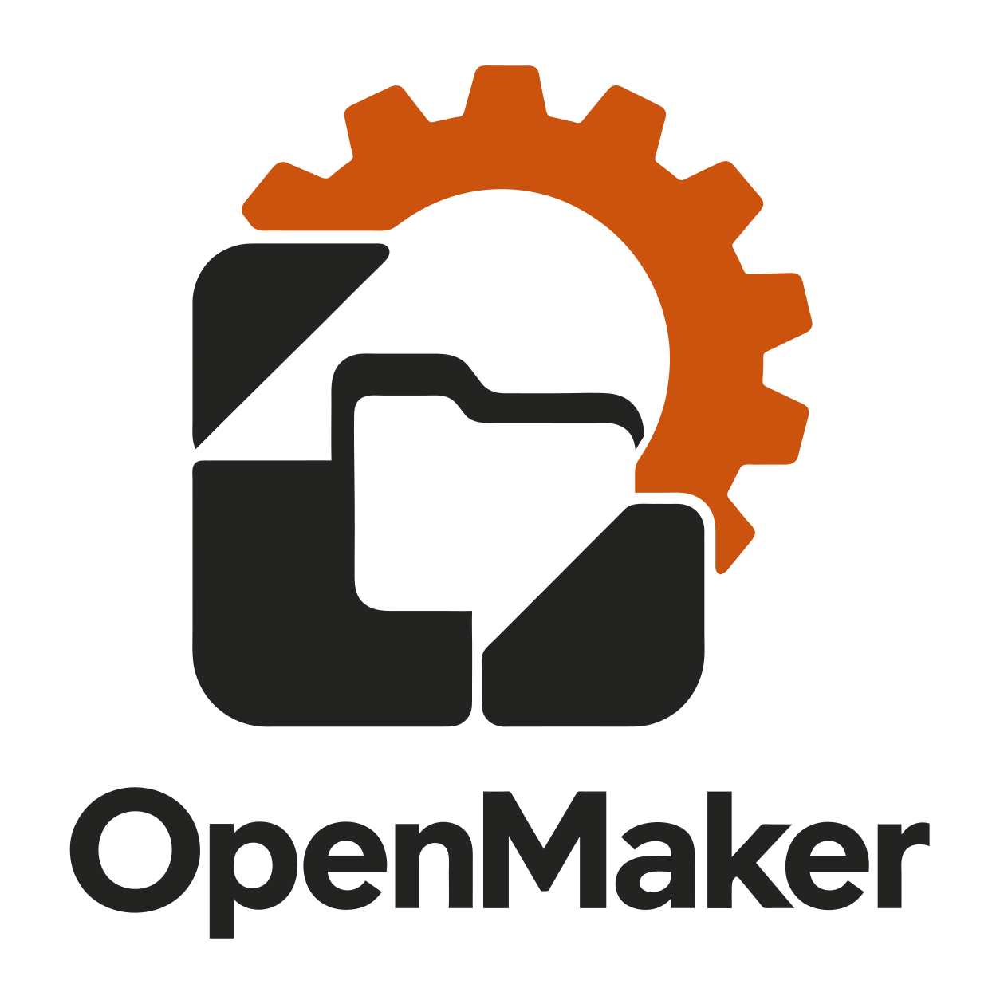

# OpenMaker

<p align="center">
  <picture>
    <source media="(prefers-color-scheme: dark)" srcset="docs/assets/openmaker-logo-dark.svg">
    
  </picture>
</p>

An open-source replacement for Claris FileMaker, written in Rust:

- **OpenMaker** (`om-gui`), a desktop client compatible with FileMaker
  Pro 26. It opens files hosted by FileMaker Server or OpenMaker Server and
  `.fmp12` files on the computer itself, with FileMaker Pro's chrome:
  Browse, Find, Layout and Preview modes and the developer tools.
- **OpenMaker Go** (`mobile/`), a mobile client for iPhone, iPad and
  Android in the manner of FileMaker Go. Its Launch Center, sign-in,
  toolbars and menus are the platform's own (SwiftUI, Jetpack Compose);
  the file's layouts are drawn and run by the desktop client's window.
- **OpenMaker Server** (`om-server`), which hosts `.fmp12` files for
  FileMaker Pro clients the way FileMaker Server does.

On the desktop, Claris ships no Linux client, so Linux (Ubuntu) comes
first, then macOS and Windows. OpenMaker Go runs on iOS, iPadOS and
Android.

**Status: pre-alpha.** Hosted and local files open, layouts render from
the file, and records can be found, sorted, edited and saved; the
calculation, script and SQL engines run in both client and server. Much of
FileMaker is still partial or missing; [ROADMAP.md](ROADMAP.md) has the
status by area, and the [client progress map](docs/client-progress.md) a
pinned snapshot of 68 capability groups with their supported scope and
remaining work.

## Quick start

```sh
cargo run -p om-gui                                  # the desktop client
OPENMAKER_PROVIDER=mock cargo run -p om-gui          # sample data, no server
```

In the client, **File > Open...** opens a `.fmp12` file on this computer,
and Home's Hosts (or File > Hosts > Open Network File...) connects to a
server. To host a copy of a file with
OpenMaker Server and open it from the client, follow
[Hosting a file and opening it](docs/development.md#hosting-a-file-and-opening-it). Requirements, environment
variables, tests and tools: [docs/development.md](docs/development.md).

To build OpenMaker Go for the iOS Simulator, an iPhone or iPad, or an
Android device, follow [mobile/README.md](mobile/README.md).

To work on a hosted FileMaker solution with a coding agent, follow the
[agent authoring quickstart](docs/authoring.md#quickstart) to set up `om-author`
and register its MCP server.

## Clean-room provenance

OpenMaker is implemented only from written specifications of FileMaker's
formats, protocol and behavior in [`docs/re/`](docs/re/README.md), from
captured traffic, and from observed behavior. No code is copied or
translated from FileMaker binaries.

## Documentation

| Document | Contents |
|---|---|
| [ROADMAP.md](ROADMAP.md) | Status by area, the alpha gate |
| [docs/client-progress.md](docs/client-progress.md) | Pinned capability map: 68 groups, supported scope, remaining work |
| [AGENTS.md](AGENTS.md) | Rules and workflow for contributors and AI agents |
| [docs/architecture.md](docs/architecture.md) | Principles, crate map, seams, testing method |
| [docs/development.md](docs/development.md) | Build, run, check, debug; research tools |
| [docs/re/](docs/re/README.md) | FileMaker specifications and findings |
| [docs/authoring.md](docs/authoring.md) | `om-author`: letting coding agents edit FileMaker solutions |
| [docs/mobile-client.md](docs/mobile-client.md) | OpenMaker Go, the iOS, iPadOS and Android client: what it does and its limits |

Feature notes in `docs/` (desktop client, mobile client, scripting,
printing, preview, PDF, reports and others) describe what OpenMaker does
and its limits; ROADMAP.md links each from its area.

## Contributing

[CONTRIBUTING.md](CONTRIBUTING.md) has the clean-room rules every
contribution follows and how to file issues and pull requests;
[AGENTS.md](AGENTS.md) has the full workflow. Report security problems
privately, as [SECURITY.md](SECURITY.md) describes.

## License

OpenMaker is released under the [MIT license](LICENSE). Bundled
third-party data keeps its own license next to it: the Inter font
(`crates/om-gui/assets/fonts/Inter-LICENSE.txt`, SIL Open Font License), the
Liberation Sans font (`crates/om-gui/assets/fonts/LiberationSans-LICENSE.txt`,
SIL Open Font License) and Unicode collation data
(`crates/om-collate/data/LICENSE-UNICODE`).

FileMaker and Claris are trademarks of Claris International Inc. OpenMaker
is not affiliated with or endorsed by Claris.
