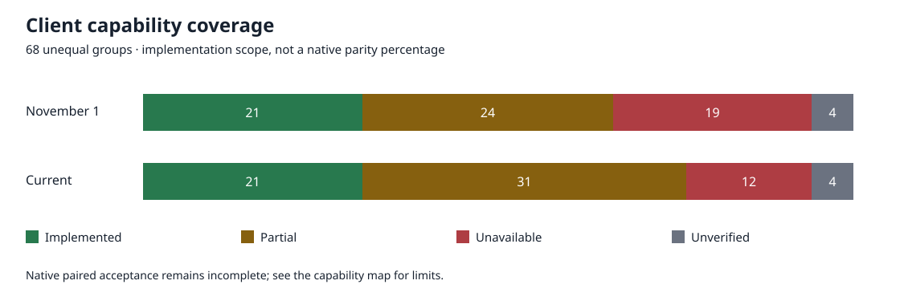

# Client progress map

This snapshot covers main `44aa30e28ea780084bb8f5e86ce1403648a78671` (November 2). On November 10 the rows that later merges changed (C01, C16, C27, C52 and [Agent-native development](#agent-native-development)) were checked again against main `c0677a6c22dddadf92a4aaacaa69cdc02d3b093c`, after #341 the sources of C42, C45 and C63 against main `c6718ae392f0502c8bca881105fad31a33b61af7`, after #342 and #355 C52, C65 and [Agent-native development](#agent-native-development) against main `9f625b8f9ab126e200565425269a1572323766a9`, after #365 C45 against main `2093ef027e238b329e1f14e982a864829a4c6794`, after #371 C45 again against main `8c8226d9968016b2872fdb9dcf93b1e33b437d51`, after #374 C18 against main `f46a195cb2a1c8cee0c4685e6701f2bb35cdd941`, after #377 C45 against main `8ab436cc87b30931803c40b1283ef893b92243a6`, after #381 C41 and C42 against main `82a510651322e6bc501e8e9a17e3db139259095d`, after #390 C18, C35 and [Agent-native development](#agent-native-development) against main `ded9ac173853fba48ec60c7a33dda4afb93585b9`, and after #384 and #393 C10, C41 and C42 against main `9b408010376ad7f725fe00bec207c16ce6af0b95`. On November 11, after #408, C18 and C35 were checked again against main `bc3d802a39a1c9de3062b928177c5fdfe0a7d89e`. These are row rechecks, not a new audit of the client or of native behavior: no other group was audited again and no classification changed. The [JSON](client-progress.json) contains the same 68 groups and the [chart](assets/client-progress.svg) compares their classifications with the November 1 baseline.

Conservative implementation coverage for 68 unequal capability groups, retaining baseline classifications except evidenced promotions. Not a new native parity assessment or an overall parity percentage. Implemented means a working covered path, not every FileMaker behavior. Native paired acceptance remains incomplete.

| Classification | November 1 | Current |
|---|---:|---:|
| Implemented | 21 | 21 |
| Partial | 24 | 31 |
| Unavailable | 19 | 12 |
| Unverified | 4 | 4 |

The November 1 baseline is commit `5ba9db602184143e944e0f0acb8350e861cc9e05`. Seven previously unavailable groups now have a supported slice: local opening, imported-table layouts, external triggers, printing, PDF, layout-object placement and Web Viewers. Moving a group to Partial does not imply complete native parity.

## Capability map

The remaining column records limits and acceptance work for a future owner. It does not schedule or authorize another feature wave.

| ID | Capability | Coverage | Supported scope | Remaining / acceptance |
|---|---|---|---|---|
| C01 | Hosted account sign-in | Implemented | Open a named hosted file with account credentials; basic native connection path exists. A host's refusal after too many failed logins (error 214) is reported as such. #324 | Broaden native host/version/account matrix and startup error cases. |
| C02 | Hosted-file discovery UI | Partial | OpenMaker Server file listing, filtering and selection; manual filenames on Claris hosts. #107 | Claris enumeration, LAN discovery and per-account lists remain unavailable. |
| C03 | Standalone local .fmp12 client opening | Partial | Local file opening, authenticated edits and atomic persistence through a private loopback engine; related local files use individual authenticated sessions. #105 #111 #114 | Only verified built-in Full Access file accounts; no encryption, Guest/external accounts, sharing, or writable files without supported locks. |
| C04 | Open File / Close File sessions | Partial | Same-host and local plain-name file sessions, ordered alternatives, owning-file identity, leases and caller continuation. #80 #114 | Local folder/volume/network paths and alternative-account prompting remain unsupported. |
| C05 | Connection loss and pending edits | Partial | User-invoked reconnect retains edits, reconciles interrupted saves and offers explicit recovery choices. #106 | No automatic/crash recovery, script resumption or recovery of lost transactions. |
| C06 | Client license integration | Implemented | Native provider supports client license selection; GUI has separate credential-store integration. | Test native first-run and restart with disposable test credentials/license. |
| C07 | Host/OS/version acceptance matrix | Unverified | Linux headless fixtures dominate recent gates; no complete macOS/Windows native-client matrix has been demonstrated. | Record supported host versions, OS builds and repeatable smoke results. |
| C08 | Stored records and typed fields | Implemented | Native pages and record IDs feed Form/List/Table; text, numeric and date/time paths are present. | Native typed-value round trips, locale and null/empty cases. |
| C09 | Create / edit / duplicate / delete | Implemented | Provider and desktop script host expose record writes, commit/revert and deletion with fixture coverage. | Disposable multi-user conflict, refused-save and cancellation acceptance. |
| C10 | Entry rules and auto-entry | Implemented | Validation, generated values and held-import preflight were corrected in #67/#73; supported paths have regression controls. The supported exact-match text lookup form copies a stored text field from the first related record through one unsorted relationship of `=` predicates on stored text fields when a write changes the match field; the looked-up value appears when the record is written, not when Tab leaves the match field. #384 | Compare native fill-only, lookup, unique/list validation and refusal behavior. Serial numbers are reserved on the host with op72. Other lookup forms (next lower or higher value, constants, several or sorted relationships, other field types) and entry from the last visited record still make a table read-only; native selection among several matches, lookups fired by scripts and imports, and FileMaker Server's runtime are unmeasured. #186 |
| C11 | Explicit transactions and held changes | Implemented | Begin/commit/revert and held change semantics are wired through the native provider. | Compare native mixed create/edit/delete rollback and partial refusal cases. |
| C12 | Globals and repeating fields | Implemented | Window/session globals and repetitions participate in calculations and edits; high repetitions received regression coverage. | Native cross-window global visibility and high repetition round trips. |
| C13 | Stored container read / write / export | Partial | Stored containers support owning-file reads/replacement, selected-container menu insertion and exact-byte export, including no-path script dialogs. #12 #120 | Portal/related interactive targets, reference-only/external forms and interactive media remain limited. |
| C14 | Record locks and concurrent clients | Partial | Window-owned accepted-row versions preserve ordinary drafts through stale-record and lock refusals, including mixed script/UI drafts and retrying a failed new-record discard. #106 #118 | No lock at first keystroke, automatic field merging or broad native multi-client acceptance. |
| C15 | Cross-window save and record freshness | Implemented | Merged #71/#72/#81 cover same-page reload, background commits and held-click identity/mode checks. | Repeat native background Save/Next/root-close plus trigger veto/reorder cases. |
| C16 | Find requests / omit / constrain / extend | Implemented | Client and provider implement multi-request found-set operations and field matching. | Differential native result IDs for mixed requests and operators. A criterion over 10,000 characters is unreadable (error 3 in a script), OpenMaker's limit; FileMaker's is unmeasured. #322 |
| C17 | Sorting and found-set preservation | Implemented | Script sorts, unsort and window found-set isolation are wired and tested. | Native collation, mixed types, summary sorting and tie order. |
| C18 | Missing-index finds / exists / value lists | Partial | Merged #65/#73/#74 add bounded fallbacks and response-completion checks. Supported forms/languages and resource limits are narrower than general native indexing. The provider's field-value retrieval for value-list sorting and Insert from Index returns the whole list or error 3, within its 100,000-value and 64 MiB bounds, using the host's list, its index or a scan ([what is complete and what is refused](value-lists-missing-index.md#what-is-complete-and-what-is-refused)). #374 | Cover unsupported collations/types separately; retain literal warm-index differential fixtures. Values that must be keyed in a tailored index language, or as negative, fractional or localized numbers, are refused [#195](https://github.com/OpenMaker-Dev/openmaker/issues/45) [#196](https://github.com/OpenMaker-Dev/openmaker/issues/46); FileMaker Server's reply for a list over 1,000 bytes, which comes in pieces, is not read yet #464. `HostFile::value_list_entries`, which checkbox and radio sets, pop-up menus and drop-down lists use (C35), is a separate path from this one. |
| C19 | Same-file related reads and portal edits | Implemented | Relationships, related rows and supported related writes are connected to the desktop; portal-row buttons can run scripts on the clicked related record. #110 | Direct text editing in portal rows and the full native filtered/related-create matrix remain incomplete. |
| C20 | Lazy portals and coherent reuse | Implemented | Merged #77 discovers IDs separately, loads visible bodies and guards volatile related ordering. Synthetic request counts confirm reduced body fetches. | Native latency/large-set profiling and invalidation under second-client writes. |
| C21 | Related hosted files in calculations | Partial | Same-host related catalogs and supported calculation, layout and record operations route to the owning file. #67 #96 #97 #98 #99 #100 | Compound relationships, missing-file behavior and unsupported field/source forms need broader native acceptance. |
| C22 | Imported-table layouts and cross-file GTRR | Partial | Imported-table layouts support Browse, edits, create/duplicate/delete, Find/Sort and cross-file Go to Related Record. #84 #85 #96 #97 #98 #99 #100 | Related criteria, some field types and cross-file transactions remain limited. |
| C23 | Script flow / variables / calls | Implemented | Desktop runtime supports conditionals, loops, parameters/results, nested calls and host actions in covered slices. | Native branch, abort, pause and error-path traces, including event ordering. |
| C24 | Cross-file Perform Script and continuation | Partial | Cross-file calls preserve the caller and file-local IDs; local peers open beside their owning file. #80 #114 | No local cross-host/folder-path support or prompt for another account. |
| C25 | Local layout / object / record triggers | Partial | Layout/object/record events and vetoes use the owning context. Browse text/control-key triggers preserve the original editor, modifier values and queued input order. #81 #110 #119 | Find/Preview keys, IME, keypad-Enter distinction and native event/focus timing remain incomplete. |
| C26 | External trigger routing | Partial | External layout/object triggers dispatch into the owning file session, including queued starts. #83 | Stored supported source forms only; native event/focus ordering needs comparison. |
| C27 | Arithmetic / text / date / JSON / lazy forms | Implemented | Substantial calculation library plus Let/While/If/Case and repetition/related evaluation is present; no product-wide function parity count is claimed. | Broaden independent native vectors, error coercion and locale cases. JSONSetElement refuses a result nested deeper than 1,000 levels or more than 1,000,000 new array elements in one call, OpenMaker's limits; FileMaker's are unmeasured. #319 |
| C28 | Get / design / login metadata | Partial | Owning-file privileges and desktop user name are available. Local account-type/password-expiry facts retain their owning-file context and refresh across date rollover. #70 #76 #78 #121 | Hosted account facts may be unavailable; some selectors and native UserName preference policy remain deferred. Password-day parity is unmeasured. |
| C29 | Pending container / nested evaluation | Implemented | Merged #12 propagates pending inputs and variable provenance across nested hosts, SQL, selectors and batching in retained regression probes. | Native asynchronous complex-calculation comparisons and request-count invariants. |
| C30 | Server scripts and callbacks | Implemented | Provider forwards Perform Script on Server and callback replies; desktop host schedules callback context. | Native callback timing, server refusal, file ownership and close/loss cases. |
| C31 | Form / List / Table browsing | Implemented | Native records and layout geometry feed the main browse views with virtualized rows. | Match native record, view, zoom and geometry before visual comparison. |
| C32 | Styled text / borders / placement | Partial | Styles, images, bounds, merge text and data formats render; precise native font metrics, borders and text placement still need the S13 oracle. | Golden disposable layouts at multiple DPI/zoom levels with measured geometry. |
| C33 | Conditional visibility / styles / tooltips | Partial | Visibility distinguishes real show/hide results, unavailable-input placeholders and pending calculations; Get context changes invalidate cached results. #102 | Find-mode hide options, complete formatting provenance and native missing-button acceptance remain incomplete. |
| C34 | Popovers / tabs / buttons | Implemented | Popover/tab interaction and button/portal-row actions use owning-window context and trigger vetoes; button bars evaluate active segments. #79 #110 #115 | Native focus/event ordering and some portal/button-bar forms remain limited. |
| C35 | Option controls and value selection | Partial | Own-table single-repetition checkbox/radio sets support mouse/keyboard edits, primary-value storage behind secondary labels, per-object triggers and save/readback. Own-table pop-up menus showing one repetition, with Edit field entry, open in Browse on a custom list or a list of a field's values in this file: the closed control shows the stored value's label, and a chosen item goes through the shared choice operation into the record's draft, then the typed-edit path (OnObjectModify, validation, lock, commit). A drop-down list stays the field's edit box and opens the same items from its arrow, or, without the arrow, when the field is entered; a chosen item takes the same path, and Escape closes the list and keeps the draft. A drop-down calendar of a date field offers a calendar the same way; a picked day is stored as a typed date is. In portal rows and of related fields one relationship away, menus, sets, lists and calendars edit the related record, committed with the record (#537); in a portal's creation row a choice begins the related record (#585). #122 #390 #408 | Repeated sets, menus and lists, related controls' object triggers, Other/Edit items, calendars of timestamp fields, auto-complete, the keyboard in a menu or list beyond Escape, also-display labels and calculated entry remain limited; text fields do not yet honor the option-set entry guard. Another file's or a calculated list, and more than 100,000 items, are refused. The menu's and list's position, width and timing, how a second-field list labels its items, and the order of triggers on a choice are not compared with FileMaker Pro. #178 |
| C36 | Window styles / cards / modality / arrange | Partial | Document, embedded Card and modal Dialog windows support parent ownership, focus restoration and close refusal. #113 | Floating documents, Arrange Window and several window option bits remain unsupported or unmeasured. |
| C37 | Zoom / wheel / Freeze / Scroll Window | Partial | Zoom/wheel, Freeze and scripted Home/End/Page/Selection scrolling use queued focus and fresh geometry. #66 #82 | Native multi-layout, input-method and separate-window behavior needs comparison. |
| C38 | Targeted Refresh Object / Portal / Window flags | Partial | Named object/portal refresh, window cache flags and join/external invalidation preserve supported Browse drafts. #87 #88 | Targeted display is bounded to supported object forms in Browse Form/List. |
| C39 | Native charts and interactive media | Unverified | No end-to-end native chart/interactive audio-video acceptance was found in the inspected client evidence; generic object presence is insufficient. | Inventory object render paths, then generated chart/PDF/audio/video fixtures. |
| C40 | Page Setup / printer dispatch | Partial | Shared paper/orientation settings, printer dispatch, copies and physical page ranges. #90 #92 #95 | Windows printing, advanced driver options, settings persistence and native printer acceptance remain. |
| C41 | Paginated Preview / subsummary reports | Partial | Shared physical pages include title/grand parts, sorted nested subsummary groups and supported slide-up/part shrinking. Ordinary buttons without an icon and plain groups, nested groups included, print in Preview, PDF and Print from the one report scene; their scripts are not run ([buttons and groups](portable-pdf.md#buttons-and-groups)). Frames whose four corners share an absolute radius print rounded, with a border that is the same on every side ([rounded frames](portable-pdf.md#rounded-frames)). #89 #94 #101 #103 #117 #381 #393 | No slide-left, hide-when-printing, bodyless reports, related break fields or part page breaks; native output equivalence unmeasured. Button icons, rounded frames with differing corners, a relative or automatic radius, a border that differs by side or is as wide as the frame, rounded pictures and parts, rotation, hide and conditional calculations, popover buttons, button bars, portals, tab and slide panels and other containers still refuse the report with error 3; FileMaker's printing of buttons, groups and rounded frames is inferred, not compared. #263 |
| C42 | Save Records as PDF / PDF script workflows | Partial | Searchable vector PDF shares report geometry with Preview/Print, including static PNG/JPEG, grouped summaries and supported sliding. Scripts, File > Save/Send Records As > PDF and the Share menu's and Preview toolbar's Save as PDF run the same step, with its dialog for the records being browsed or the current record. Ordinary buttons without an icon, plain groups and rounded frames print as in Preview (C41). #86 #94 #101 #103 #117 #341 #381 #393 | Advanced PDF options, Save Records as PDF in server scripts and native FileMaker acceptance remain limited. Layouts with the objects C41 lists as refused (other containers, button icons, the rounded frames it names) refuse the PDF too. [#261](https://github.com/OpenMaker-Dev/openmaker/issues/104) #263 |
| C43 | Text / spreadsheet import by script | Partial | File-menu and script CSV/TSV/XLSX imports support field mapping and match keys. #93 | Other source types, new-table import and the native picker remain unavailable. |
| C44 | FileMaker / folder / ODBC / legacy import | Unavailable | Import source_kind 2 and FileMaker/Folder/ODBC/Excel2003 profiles return Unsupported. | Implement one source class per feature PR with mapping and failure tests. |
| C45 | Export Records: script vs menu | Partial | File-menu export exposes supported formats and the owning found set, using the existing script export engine. File > Save/Send Records As > Excel and the toolbars' Save as Excel run Save Records as Excel through the shared command, for the records being browsed or the current record. A script step stored with Current record and Restore writes only the current record, as FileMaker Pro 26 does with the dialog off. Without groups, Export Records and Save Records as Excel write each record's own running total and fraction of total, matching FileMaker Pro 26's tab-separated and whole-found-set Excel output for a running total without restart and a fraction without subtotal. In a grouped export, the desktop and OpenMaker Server both write the found set's grand summary on the first row, as FileMaker Pro 26 does locally for a running total and a fraction of total. #91 #341 #365 #371 #377 | Grouping editor, saved settings and further format/layout options remain. Restarting, subtotaled and other summary options, break-field rows of grouped exports, grouped Excel and other formats, the current-record Excel row and FileMaker Server's values are unmeasured. Save Records as Excel with its dialog on is not compared with FileMaker Pro. [#372](https://github.com/OpenMaker-Dev/openmaker/issues/139) |
| C46 | Data-file I/O and container/text export | Implemented | Desktop host wires data-file operations and container export; narrow native binary/text-export samples passed. | Expand paths, encoding, existing-file refusal and cancellation comparisons. |
| C47 | Script Workspace view / local drafts | Partial | Workspace edits steps and catalog via a provider interface; native catalog is read-only. UI capability is not native persistence. | Keep drafts recoverable; compare option editing and all step parameter forms. |
| C48 | Save scripts / script catalog to native host | Unavailable | Desktop Script Workspace drafts locally against native hosts. OpenMaker-hosted script-step replacement is separately available through om-author. #108 | Claris FileMaker Server script/catalog persistence is unavailable. |
| C49 | Manage Database / schema inspection | Partial | Native tables/fields and decoded relationships are readable; supported edits to tables, normal fields, their auto-enter, validation and storage options, occurrences and relationships are saved with FileMaker Pro's schema transaction on OpenMaker Server and local files. | Other relationship tools; calculated and looked-up values, value lists, ranges, validation calculations and custom messages; calculation and summary fields; FileMaker Server saves (#430-#433). |
| C50 | Save schema definitions to native host | Unavailable | Schema inspection is available; om-author can create supported scalar fields on OpenMaker Server. #112 | Claris FileMaker Server schema mutation and general schema editing remain unavailable. |
| C51 | Layout inspection / Objects / canvas | Partial | Geometry selection and inspection exist; canvas selection does not change the document. | Native object/part metadata comparison and selection navigation. |
| C52 | Create / modify / persist layouts | Partial | om-author can durably append an own-table edit box with an optional label to an existing Form layout on OpenMaker Server. #116 | No general layout editor persistence, tab-order insertion or Claris-hosted layout saves. FileMaker Pro 26 accepted one case, an edit box without a label for a stored Text field: consistency check, Browse entry on first open, binding and its own later saves passed; other object kinds, labels and layouts are unchecked. #166 #342 |
| C53 | Script Debugger / Data Viewer | Unavailable | Tools commands are disabled; workspace explicitly reports debugger unavailable. | Breakpoints, step/call stack and watch-expression evaluation in correct context. |
| C54 | Manage value lists / menus / custom functions / DDR | Unavailable | Several management dialogs and design-report/XML tools are disabled; runtime use of stored definitions is separate. | Prioritize editable definitions and metadata export needed for compatibility work. |
| C55 | Open URL / Insert from URL | Implemented | Desktop host dispatches URLs and fetches responses through om-url, including file URLs and cooperative transfer cancellation. | Native response/encoding/target and supported option differential tests. |
| C56 | Web viewer and JavaScript bridge | Partial | Opt-in embedded WebKitGTK with JavaScript calls and script callbacks on Linux/X11 (XWayland on a Wayland session), Browse Form, first file window. #109 | No macOS, Windows, native Wayland, List/portal rows or Find content; native parity unmeasured. |
| C57 | Send Mail and platform automation | Unavailable | Mail and platform automation steps fall through unsupported desktop host paths. | Separate generic mail transport, macOS automation and Windows dispatch features. |
| C58 | ExecuteSQL calculation host | Implemented | SQL calculation integration and cursor/container forwarding exist; pending selectors received targeted corrections. | Native query grammar, typing, joins and error behavior differential suite. |
| C59 | ESS / ODBC / external SQL tables | Unavailable | No complete desktop external SQL provider path was found; ODBC import is explicitly refused. Client ExecuteSQL calculations do not imply ESS support. | Independent SQL data-source discovery, table binding and write semantics. |
| C60 | Execute FileMaker Data API script step | Unavailable | Desktop Network implementation does not override execute_data_api; default is Unsupported. | Implement the client script-step contract and response/error mapping. |
| C61 | Third-party FileMaker plug-ins | Unavailable | Machine metadata reports no installed plug-ins; no compatible plugin execution host is demonstrated. | Assess ABI/platform strategy before committing to plugin compatibility. |
| C62 | 2025/2026 AI and model workflows | Unavailable | Pure embedding calculations exist, but inspected desktop host lacks general AI model/RAG script workflows. Function/step catalogs alone are not implementation. | Add only after core workflow priorities, using generic model fixtures. |
| C63 | Native desktop menus / common commands | Partial | Menus draw inside each window on macOS. File > Save/Send Records As > Excel and PDF, the Share menu and the Preview toolbar's Save as buttons run Save Records as Excel and as PDF through one shared command and the steps' dialogs; many other items are disabled even when related script paths exist. #341 | Audit every enabled command and keyboard route; native menu integration. Save as Snapshot Link stays disabled. FileMaker Pro's item text, dialogs and OnRecordCommit timing for these menu commands are unmeasured. [#251](https://github.com/OpenMaker-Dev/openmaker/issues/95) |
| C64 | Keyboard / clipboard / IME / accessibility | Unverified | Individual control behavior has tests, but a complete native keyboard, IME, clipboard and assistive-technology audit is not established. Disabled Edit menu entries alone do not prove widget shortcuts fail. | Manual OS-level input matrix with Unicode, selection, paste and accessibility navigation. |
| C65 | Performance / memory / render caches | Partial | Merged #68/#77 and bounded scans improve supported paths; synthetic request counts and frame tests are not a native workload latency claim. Query programs find index keys by binary search, measured on synthetic programs against earlier OpenMaker only ([method and results](performance/query-index-lookups.md)). #355 | Compare cold/warm latency, memory and request counts on generated small/large solutions. |
| C66 | File recovery / copy / conversion tools | Unavailable | Create New, Save a Copy As and Recover are disabled; read-only file-format tooling is separate. | Scope local persistence first, then copy/recovery with disposable corruption fixtures. |
| C67 | Peer-to-peer file hosting from the client | Unavailable | NativeProvider consumes hosted sessions; no interactive client-hosted sharing workflow was identified. Standalone om-server is a separate component. | Define supported client-hosting contract separately from Server replacement. |
| C68 | Broad native workflow / every-button parity | Unverified | Reviewed automated slices and synthetic end-to-end tests cover a growing subset of client workflows. | No complete every-button or broad native workflow equivalence claim. |

## Agent-native development

The JSON CLI and MCP service go beyond replacing the desktop UI. Both read one catalog of commands, which `om-author commands` lists with their parameters without a connection. On OpenMaker Server, an agent can inspect metadata, replace an existing script’s steps, create supported scalar fields, place an edit box with a label on an existing Form layout, and run a script with Perform Script on Server to read its last error and result. `list_choices` lists the items a field control's value list offers on a record, complete or as an error; `choose_value_list_item` needs a desktop window, so it answers error 3 (`no_window`) and changes nothing. Design mutations require supported Full Access authorization, revision checks, locks and persisted read-back verification; script execution uses the host account's ordinary script permissions. See [authoring](authoring.md).

These operations do not enable script, schema or layout saves to Claris FileMaker Server, and `run_script` has run against OpenMaker Server only. In FileMaker Pro 26, one stored Text field added this way and its edit box, placed without a label on a Form layout of a starter-solution copy, passed the consistency check and opened without a warning; Browse showed the edit box on first open and kept the value entered in it after reopening, Manage Database and Layout mode showed the field and its binding, and FileMaker Pro's own later field and layout saves kept all of it (#166, #342). Earlier placements without the part list entry were not shown in Browse. The 14-point box clipped its unfocused text under the theme's padding, a separate limit. Other authoring outputs have not been opened in FileMaker Pro.

## Handoff boundaries

Completed slices retain their documented refusals. Synthetic tests and independent review establish only their tested scope; precise rendering, broad platform behavior and native workflow equivalence still need native witnesses. Fine-grained remote server privileges and security hardening remain incomplete.

This map is a snapshot. Re-check current main and open PRs before continuing a deferred item; the snapshot itself does not start new development.
